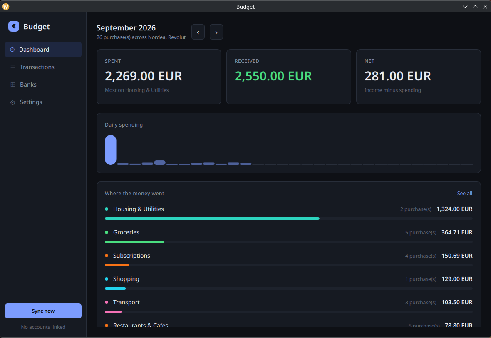

# Budget

A Qt 6 / QML desktop app that pulls your Nordea and Revolut purchases together
and shows where the money went.



## Getting your real data

This is the part worth reading before anything else, because the obvious route
does not exist.

**Neither bank will give you direct API access to your own personal accounts.**
Nordea's Open Banking production API is gated behind a licensed PSD2 AISP
registration with an eIDAS certificate, which an individual cannot obtain — its
sandbox is open to anyone, but only serves fake data. Revolut has no personal
account API at all; its Business API needs a Revolut Business account on the
Grow plan or above, and its Open Banking API is for regulated third parties.
Nordigen/GoCardless, which used to be the free workaround, closed to new
signups in 2025.

So the app takes the two routes that actually work for a private individual:

### 1. Live sync via Enable Banking (recommended)

[Enable Banking](https://enablebanking.com) is a licensed account-information
provider with self-serve signup. Its **restricted production** mode is designed
for exactly this case: you link *your own* accounts to your own application and
read them live. Nordea and Revolut both go through this single code path.

Nothing in that path is bank-specific: the app fetches the supported bank list
from `/aspsps` at runtime, so **any ASPSP Enable Banking covers works with no
code change**. In Finland that includes S-Pankki, OP, Danske Bank, Aktia and
Säästöpankki alongside Nordea. S-Pankki authenticates through S-mobiili, which
is an ordinary redirect flow and needs no special handling.

Several banks can be linked at once — each consent is stored as its own session
and a sync fans out across every account in all of them. That matters when a
bank exposes its credit cards as a separate entry from its current accounts:
just run the connect flow twice.

**Credit cards** are handled as first-class accounts. A card has no IBAN, so it
is identified by the masked PAN the bank reports under `account_id.other`, and
`cash_account_type: CARD` is used to label it in the account list.

1. Register an application in the Enable Banking control panel.
2. Generate an RSA key pair and upload the public half:
   ```sh
   openssl genpkey -algorithm RSA -pkeyopt rsa_keygen_bits:2048 -out enablebanking.pem
   openssl rsa -in enablebanking.pem -pubout -out enablebanking.pub
   ```
   Keep `enablebanking.pem` private — the app only stores its *path*.
3. Whitelist the redirect URL the Settings screen shows you
   (`http://127.0.0.1:8765/callback` by default).
4. Activate the application in restricted mode by linking your own accounts.
5. In **Settings**, enter the application ID, point at the private key, set your
   country, and save.
6. In **Banks**, load the bank list, pick Nordea, complete the consent flow in
   the browser, then do the same for Revolut. Hit **Sync now**.

Consent lasts up to 90 days, after which the bank asks again.

### 2. Trading 212 (its own API)

Trading 212 is a broker, not a bank. It has no PSD2 interface — it *consumes*
open banking for deposits rather than exposing accounts — so the aggregation
route above cannot reach it. It does have a free
[public API](https://docs.trading212.com/api): generate a key pair in the app
under **Settings → API** with history access, then paste **both the key and the
secret** into **Settings → Trading 212**. The API authenticates with HTTP Basic,
taking the key as the username and the secret as the password. The pair is
written to an owner-only file rather than into the settings.

Card spending is fetched the long way round, and deliberately so. The API's
`/history/transactions` endpoint reports card payments with an opaque UUID
instead of a merchant name, which is useless for budgeting. The CSV the export
endpoint produces *does* carry `Merchant name` and `Merchant category`, so the
app requests an export, polls until it is built, downloads it and parses it.

The export endpoints are heavily rate limited — one request per 30 seconds to
ask for a report and one per minute to check on it — so a Trading 212 sync
takes a minute or two rather than the moment a bank sync takes. Polling any
faster just spends the budget on `429`s.

Two things about the export are worth knowing:

- **Share trades are dropped.** A market buy moves cash into holdings; it is not
  money leaving your pocket, and counting it would make investing look like
  spending.
- **Deposits and withdrawals are transfers**, because the other leg is already
  on the account that funded them.

### 3. Statement import (works immediately, no credentials)

Export a CSV from your bank, or from Trading 212's own history export, and use
**Banks → Import a statement**. A Trading 212 file is recognised from its
header and gets the same treatment as an API-fetched one, including the same
row ids, so importing a period you already synced changes nothing. Columns are
matched by header name, covering Revolut's layout, the Finnish, Swedish and
English variants of Nordea's export, and the shared Finnish vocabulary the
other domestic banks use (`Maksupäivä`, `Summa`, `Saajan nimi`, `Selite` and so
on). Rows already pulled from the API are not duplicated.

Only Nordea and Revolut can be identified from their headers alone — the
remaining Finnish banks share too much column vocabulary to tell apart, and
guessing would silently mislabel rows and break the per-bank filter. Use the
**From** dropdown to name the bank when importing one of those; leave it on
*Detect automatically* for Nordea and Revolut.

If a file does not import, the error message quotes the header row it found —
that is usually enough to see which column alias is missing.

## Building

Requires Qt 6.5+ (built against 6.11), CMake 3.21+, OpenSSL and a C++20
compiler.

```sh
cmake -S . -B build -G Ninja -DCMAKE_BUILD_TYPE=Release
cmake --build build
./build/budget_app
```

Run the tests with:

```sh
ctest --test-dir build --output-on-failure
```

## How it is put together

```
src/
  core/        Transaction value type, integer money, merchant categorisation
  data/        SQLite store + the models QML binds to
  net/         RS256 JWT signing (OpenSSL) and a small JSON HTTP client
  auth/        Loopback redirect listener, persisted settings
  providers/   EnableBankingProvider (banks), Trading212Provider (broker API)
               and CsvProvider (import), behind one Provider interface
  app/         AppController — the single object QML talks to
qml/           Main window, four views, reusable components
tests/         Unit tests for money, CSV, categorisation, storage and JWT
```

Providers share one `Provider` interface and emit normalised `Transaction`
rows, so the live API and a CSV file are indistinguishable downstream. The
SQLite store is the source of truth: the UI reads only from it, which is why
the app stays usable offline and why a sync that fails halfway never leaves a
half-populated screen.

A few decisions worth knowing about:

- **Money is never a float.** Amounts are signed integer minor units end to
  end; parsing and formatting are the only places a decimal exists.
- **Rows are deduplicated on a stable id** — the bank's own reference when it
  supplies one, otherwise a hash of date, amount, description and an ordinal so
  two identical coffees on the same day stay two rows.
- **A category you set by hand outranks the categoriser** and survives
  re-syncing.
- **Pending rows are shown as pending** and are overwritten in place when the
  bank books them, including a corrected amount.
- **Transfers between your own accounts are left out of the totals.** Paying a
  credit card bill, or topping up Revolut from your bank, appears once on each
  account; counting either leg would inflate both spending and income. The net
  card says how much was excluded.
- **Portfolio activity is not spending.** Share trades are excluded; dividends,
  interest and cashback are counted as income.
- **Transaction direction follows the bank.** `credit_debit_indicator` decides
  it when present, and the amount's own sign when it is absent, which is what
  the Berlin Group schema specifies.

## Where your data lives

| What | Where |
|---|---|
| Transactions | `~/.local/share/budget-app/Budget/transactions.sqlite` |
| Category rules | `~/.local/share/budget-app/Budget/categories.json` |
| Application ID, key path, sessions | `~/.config/budget-app/Budget.conf` |

Nothing is sent anywhere except to the Enable Banking API, and the private key
is read from the path you configure rather than copied into the app's own
storage.

Edit `categories.json` to change how purchases are grouped — it is a plain
`{"Category": ["regex", ...]}` map, applied in order, first match wins.
